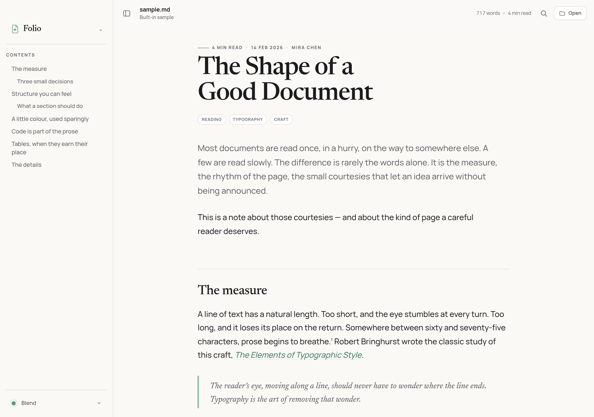
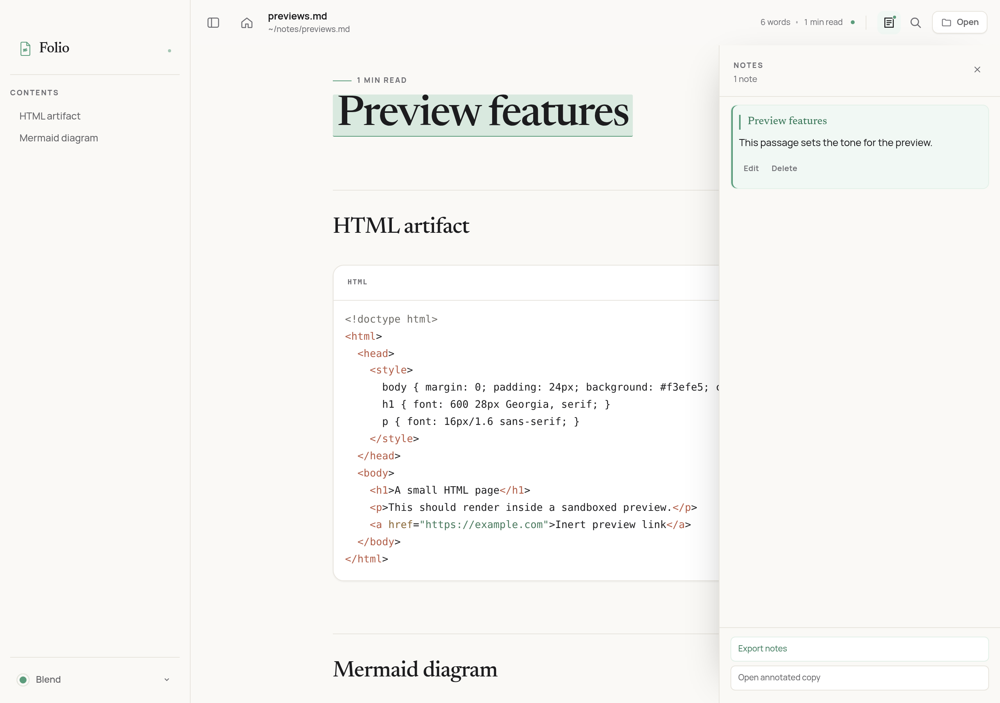

# Folio

**A quiet, native Markdown reader for macOS.** Folio turns the Markdown your
agent writes into a designed document: one reading column, careful typography,
a contents rail, live reload, and themes that feel like rooms rather than
skins.

It is not another Markdown editor, and it is not a browser tab. It is a small
native app built on a Rust rendering engine and the system WebView. No
frontend framework, no bundled browser, no 200 MB Electron shell.



## Why

Agent-generated notes are usually excellent prose trapped in a file that looks
like source code. Markdown is the right format for the model: cheap, portable,
easy to diff. It is a poor format for a reader. Folio keeps the file as it is
and gives it a page.

## What you get

- **A reading page, not a preview.** A measured column, display type, a lead
  paragraph, quiet rules, generous rhythm.
- **Blend by default.** Cream, ink, sage, Newsreader and Manrope — the visual
  language of the Blend design system, tuned for long-form reading.
- **Six themes, or your own.** Blend, Blend Dark, Editorial, Editorial Dark,
  Studio, and Studio Dark ship with the app. A theme is a validated JSON file;
  match the system appearance with a paired theme.
- **Live reload.** Folio watches the document and re-renders when it changes,
  keeping your place on the page.
- **A gentle default-app offer.** On the first Markdown open, Folio can offer
  to become your default `.md` app — Yes, No, or Never show again.
- **A real reading interface.** Sticky contents rail with scroll spy, reading
  progress, find, adjustable text size, code copy, collapsible long snippets,
  a Home button, and a native menu.
- **Marginalia without touching the source.** Select text, add a note, and keep
  the original Markdown untouched. Notes live in a sidecar, detect when the
  original changed, and can be exported or opened as a cached annotated copy.
- **A configuration file, not a settings maze.** Pin a theme, system matching,
  text size, and rail visibility in `config.toml`. Open it from the app menu or
  the theme picker; in-app controls keep working when a value is not pinned.
- **HTML artifacts you can see.** Fenced `html` blocks keep their highlighted
  source and gain **Preview** and **Open** actions. The inline preview is
  sandboxed; **Open** puts it in a separate native window. Scripts and network
  access are disabled in both.
- **Mermaid, when a document contains it.** `mermaid` fences render as
  theme-aware diagrams with a Source toggle. The renderer is loaded on demand,
  only for documents that use a diagram, so ordinary reading keeps its fast
  start.
- **GitHub-flavoured Markdown.** Tables, task lists, footnotes, strikethrough,
  smart punctuation, and all five `[!NOTE]`-style callouts.
- **Syntax highlighting without a highlighter bundle.** A small Rust lexer
  colours Rust, TypeScript/JavaScript, Python, Shell, Go, C/C++, Swift, Java,
  Kotlin, SQL, JSON, YAML, TOML, CSS, HTML, and diffs.
- **Safe by construction.** Raw HTML is shown as text, never executed. HTML
  previews are opt-in, parsed inertly, and isolated in a sandboxed iframe with
  scripts and network access disabled. URLs are classified and sanitised.
  Theme values are validated before they become CSS.
- **Small by default.** The reader UI is roughly 45 KB of JavaScript and 43 KB
  of CSS (minified, before gzip); fonts are local. Mermaid adds ~3.6 MB of lazy
  assets that are only fetched when a document contains a diagram. The native
  shell is a single Rust binary using the system WebView, not a bundled
  browser. The release shell binary measured 7.5 MB on the Linux validation
  build; the macOS bundle adds roughly 0.6 MB of reader assets, plus the
  on-demand Mermaid assets.

## Install and run

### Requirements

- macOS 12 or newer
- Xcode Command Line Tools (`xcode-select --install`)
- [Rust](https://rustup.rs) stable
- Node 22 and [pnpm](https://pnpm.io) 10

Folio's engine and UI are developed and tested on Linux. The `.app` bundle is a
macOS shell and must be built on a Mac; the included script and GitHub Actions
workflow do that with one command.

### Build the app

```sh
pnpm install
pnpm tauri build
open src-tauri/target/release/bundle/macos/Folio.app
```

For a universal binary that runs natively on Apple silicon and Intel:

```sh
rustup target add aarch64-apple-darwin x86_64-apple-darwin
pnpm tauri build --target universal-apple-darwin
```

Or use the helper:

```sh
scripts/build-macos.sh
```

The build is unsigned. Locally built apps open normally. If you copy the app
from another machine, either right-click → **Open** or clear the quarantine
attribute:

```sh
xattr -dr com.apple.quarantine /Applications/Folio.app
```

### Develop

```sh
pnpm install
pnpm tauri dev        # builds the UI, then opens the native window
pnpm dev              # rebuild the UI on change (reload the window after)
```

The rendering engine can also be used from the terminal, which is handy for
testing and for piping:

```sh
cargo run -p folio-cli -- render docs/sample.md --json
cargo run -p folio-cli -- render docs/sample.md --out /tmp/folio.html
cargo run -p folio-cli -- themes list
cargo run -p folio-cli -- themes scaffold my-theme
```

## Using Folio

Open a file with **⌘O**, drag one onto the window, double-click a Markdown file
associated with Folio, or choose **View the sample** from the welcome page.
Folio watches the file from then on. Save in your editor and the page updates.
On the first Markdown file of a session, Folio may ask whether to become the
default `.md` app. **Yes** registers it with LaunchServices; **No** asks again
next launch; **Never show again** is remembered. The prompt never appears for
the built-in sample or in a development build that is not inside an `.app`.

| Shortcut | Action |
| --- | --- |
| `⌘O` | Open a document |
| `⌘B` | Show/hide contents |
| `⌘F` | Find in the document |
| `⌘,` | Theme picker |
| `⌘+` / `⌘−` / `⌘0` | Larger / smaller / actual text size |
| `⌘R` | Re-render the current file |
| `⌘W` | Close/hide the window (reopen from the Dock) |

The theme picker lives at the bottom of the contents rail. **Match system** is
on by default: with a light system appearance the default is Blend; with a dark
appearance it is Blend Dark. Matching follows each theme's counterpart.
Selecting a theme explicitly turns automatic matching off until you turn it
back on.

### Frontmatter

A small YAML block is read for metadata and then removed from the page:

```yaml
---
title: A Quiet Document
author: Mira Chen
date: 2026-02-14
tags: [reading, craft]
description: Notes on making a page worth reading.
---
```

`title`, `description`, `author`, `date`, and `tags` are used by the document
header and the contents rail. The first `#` heading is still the visible title;
if a document has no `#` heading, the frontmatter title (or the filename) is
used instead.

### Images and links

Remote images load directly (with `referrerpolicy="no-referrer"`). Local images
are read by the Rust host and inlined as data URLs, so a document can keep
images beside it without exposing a local web server. PNG, JPEG, GIF, WebP, and
AVIF are supported; SVG previews are intentionally not inlined.

External links open in your browser. Relative links to other Markdown files open
inside Folio; other local links open in their default app.

### HTML previews and Mermaid

A fenced `html` code block is always shown as syntax-highlighted source. Use
**Preview** to render it inline; use **Open** to put the same sandboxed preview
in a separate native window.

A complete HTML document — a `.html` / `.htm` file, or a `.md` file whose body
starts with an HTML doctype/root — opens in full-document preview mode, with a
**Source** toggle and **Open window** action. Raw HTML fragments inside a normal
Markdown document remain escaped. The preview is intentionally self-contained:
inline CSS and data-URL images work, but scripts, links, external stylesheets,
remote images, and network requests are blocked.

A fenced `mermaid` block is rendered as a diagram when it scrolls into view.
**Source** switches back to the diagram source, and Mermaid re-colours the
diagram when you change themes. Mermaid supports its usual diagram types;
unsupported or malformed diagrams show their source with a short error instead
of breaking the page. Folio controls the diagram theme and security settings;
per-diagram Mermaid frontmatter or `init` config is ignored.

### Your data

Folio stores preferences, recent-file paths, window state, themes, an optional
`config.toml`, and annotation sidecars/caches in
`~/Library/Application Support/com.folio.reader`. It does not copy, upload, or
index your documents. The only network requests are remote images referenced by
a document and links you choose to open.

## Themes

Themes are JSON. The app reads them from:

```text
~/Library/Application Support/com.folio.reader/themes/
```

Create a starting point:

```sh
mkdir -p "$HOME/Library/Application Support/com.folio.reader/themes"
cargo run -p folio-cli -- themes scaffold my-paper \
  > "$HOME/Library/Application Support/com.folio.reader/themes/my-paper.json"
```

Restart Folio (or reopen the theme picker) to see it. Every value is validated:
colours must be hex or `rgb()`/`rgba()`, fonts may not contain CSS or `url()`,
and lengths must use supported units and ranges. A bad theme is skipped with a
message instead of breaking the app.

The full token reference and a worked example are in
[docs/themes.md](docs/themes.md). Themes cannot add arbitrary CSS; they can only
change the tokens.

## Configuration

Folio also reads an optional `config.toml` next to the themes folder:

```text
~/Library/Application Support/com.folio.reader/config.toml
```

Open it from **Folio → Configuration…** or **Open configuration** in the theme
picker. It can pin any of these launch settings:

```toml
# theme = "blend"        # built-in or custom theme id
# matchSystem = true     # follow the light/dark counterpart
# textSize = 1.0         # 0.85 to 1.5
# showOutline = true     # show the contents rail on launch
```

Uncomment a key to pin it; absent keys leave the in-app controls in charge. The
file is validated before it is applied and is never executed. Restart Folio
after editing. The full precedence rules, examples, and validation behavior are
in [docs/configuration.md](docs/configuration.md).

## Home and notes

Use the Home button in the topbar or **File → Home** (`⌘⇧H`) to return to the
welcome page. Folio stops watching the document while you are home; choosing a
recent reopens it and restarts live reload.

Select text in a document and choose **Note** from the small selection toolbar.
The original Markdown is never modified. Notes and an automatically cached
annotated copy live in Folio's application data directory; the Notes panel can
export a new `<name>.annotated.md` or open the cached copy. When the source
changes, Folio warns and re-anchors notes by their quoted text, marking anything
it cannot match. Details are in [docs/annotations.md](docs/annotations.md).



## Extending Folio

Folio does not ship a plugin runtime. Extensions start with themes and are
meant to stay declarative: validated JSON, no executable code, no startup cost.
If code extensions are ever needed, the preferred path is an opt-in external
subprocess plugin host rather than JavaScript in the WebView or a linked WASM
runtime. The options, hooks, security boundaries, and non-goals are recorded in
[docs/plugins.md](docs/plugins.md).

## Performance

Folio's hot path is entirely in Rust: parse Markdown once, highlight code once,
emit one HTML string, and let the system WebView paint it. There is no runtime
Markdown parser and no syntax-highlighting library in the webview.

Measured on this development machine (Linux, Chrome 156, release build):

The core renderer turns a 100 KB document into finished HTML in **1.55 ms**; a
1 MB document takes **19.8 ms** (about 50 MiB/s). The UI reaches first document
render in **under 35 ms** on the sample. A 120 KB document paints in about
0.36 s, and an extreme 700 KB document (2.2 MB of HTML) in about 1.1 s.

| Document size | Engine (criterion) | CLI end-to-end (p50) |
| ---: | ---: | ---: |
| 8 KB | 0.13 ms | 8.8 ms |
| 100 KB | 1.55 ms | 4.1 ms |
| 1 MB | 19.8 ms | 55.4 ms |
| 4 MB | — | 119.4 ms |

CLI numbers include process spawn, file read, and output write; startup varies
on a busy machine and dominates tiny files. The engine numbers are in-process
and much more stable. Full method and caveats:
[docs/performance.md](docs/performance.md).

The UI bundle is intentionally small:

| Asset | Minified | Gzip |
| --- | ---: | ---: |
| JavaScript | 45 KB | 13.9 KB |
| CSS | 43 KB | 9.2 KB |
| Fonts (local WOFF2, Latin + Latin-ext) | ~500 KB | — |
| Mermaid (lazy, only when diagrams appear) | ~3.6 MB | — |

The macOS app does not bundle a browser engine; it uses the WebView already on
the system. Mermaid is not requested at launch.

### Downloads

Published releases attach the DMG (`Folio_*.dmg`) and `Folio.app.zip`. The
**Source code** archives GitHub generates for every tag are source only, not
applications. Actions artifacts are temporary; use the DMG or app zip from a
release for a permanent download. The direct Actions artifacts are also
available from the workflow run page and expire automatically.

The end-to-end suite needs a local Chrome (set `CHROME_BIN` if it is not in a
standard location). On macOS, Folio can also be measured by building the `.app`
and using Instruments or `open -W` for launch timing.

## Tests and benchmarks

```sh
cargo test                         # engine + CLI (unit, integration, XSS, themes)
pnpm typecheck                     # strict TypeScript
pnpm test:e2e                      # real Chrome: rendering, themes, find, a11y, perf
pnpm bench:ui                      # paint medians in headless Chrome
pnpm bench                         # criterion: render + highlight throughput
pnpm bench:cli                     # release CLI wall-clock, including process start
pnpm bench:ui                      # headless Chrome paint medians
pnpm screenshots                   # visual review set in artifacts/screenshots
```

The end-to-end suite drives the actual built UI against a fixture generated by
the Rust renderer, checks axe accessibility on every theme surface, exercises
the clipboard and keyboard shortcuts, and measures a roughly 700 KB document.
See [docs/performance.md](docs/performance.md).

## How it works

```text
Markdown file
   │
   ├── Rust core (folio-core)
   │     frontmatter → pulldown-cmark → sanitised HTML + outline + stats
   │     syntax highlighting, link/image resolution, theme validation
   │
   ├── Tauri shell (src-tauri)
   │     native window, menus, dialogs, live file watch, recents, local images
   │
   └── WebView UI (ui)
         frameless HTML + vanilla TypeScript + theme CSS variables
```

- **No raw HTML execution.** HTML events are escaped and shown as source.
- **URL allowlist.** `javascript:`, `data:` links, and other unsafe schemes are
  blocked; links and local images are classified in Rust.
- **Themes are data.** The theme catalog is validated in Rust and emitted as
  CSS custom properties.
- **One render pass.** The renderer buffers only headings, paragraphs, images,
  and footnote definitions; the rest streams directly into the output.

More detail: [docs/architecture.md](docs/architecture.md) and
[docs/design.md](docs/design.md).

## Project layout

```text
crates/folio-core/     Markdown renderer, highlighter, paths, themes (Rust)
crates/folio-cli/      `folio` command-line renderer
src-tauri/             macOS shell: window, menu, watcher, IPC
ui/                    Vanilla TypeScript UI and the document stylesheet
docs/                  Design, theme, plugin, performance, and architecture notes
tests/e2e/             Chrome end-to-end, accessibility, and screenshot suite
bench/                 CLI benchmark harness and corpora
```

## License

The Folio code is MIT licensed (see [LICENSE](LICENSE)). Bundled typefaces are
under the SIL Open Font License; see [THIRD_PARTY.md](THIRD_PARTY.md).

## Credits

- The default **Blend** theme is an adaptation of the Blend design system by
  the Blend project (cream, ink, sage, terracotta; Newsreader + Manrope).
- Typefaces: [Manrope](https://github.com/sharanda/manrope) by Mikhail Sharanda
  and [Newsreader](https://github.com/productiontype/Newsreader) by Production
  Type, both under the SIL Open Font License. License texts are included in
  `ui/assets/licenses/`.
- Markdown parsing: [pulldown-cmark](https://github.com/pulldown-cmark/pulldown-cmark).
- Native shell: [Tauri](https://tauri.app).

Folio is a local reader. It has no accounts, telemetry, or cloud.
