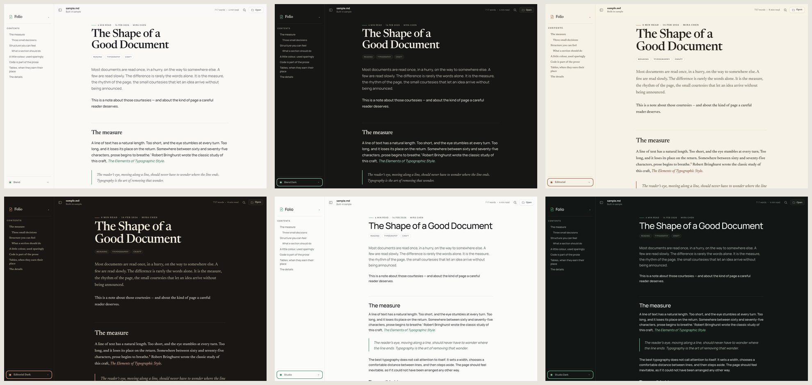

# Themes



A Folio theme is a small JSON document of design tokens. The app validates it,
then turns it into CSS custom properties. A theme cannot add arbitrary CSS, run
code, or reach the network — which is what makes it safe to hand a theme file to
someone else.

## Where themes live

Built-in themes are compiled into the app. Your own themes live in one folder:

```text
macOS:  ~/Library/Application Support/com.folio.reader/themes/
Linux:  ~/.config/com.folio.reader/themes/   (development builds)
```

Add or edit a `*.json` file there and restart Folio. The theme picker shows your
themes alongside the built-ins. Invalid files are skipped and reported in the
picker; one bad theme cannot break the app.

Create a starting point:

```sh
cargo run -p folio-cli -- themes scaffold my-theme \
  > "$HOME/Library/Application Support/com.folio.reader/themes/my-theme.json"
```

Then open the file and change the tokens. Restart the app.

## The shape of a theme

```json
{
  "id": "quiet-paper",
  "name": "Quiet Paper",
  "description": "Warm paper and a softer accent for late reading.",
  "appearance": "light",
  "counterpart": "quiet-paper-dark",
  "colors": {
    "canvas": "#FAF7F0",
    "surface": "#FFFFFF",
    "surfaceMuted": "#F2EDE3",
    "ink": "#25221D",
    "muted": "#625C52",
    "subtle": "#6E675C",
    "accent": "#5C9C7C",
    "accentStrong": "#3F7A5D",
    "accentSoft": "#F0F7F2",
    "accentLine": "#E0EEE5",
    "warm": "#A94F39",
    "warmSoft": "#F7EBE6",
    "rule": "#E5DED1",
    "selection": "#DFE9E1",
    "shadow": "rgba(40, 33, 24, 0.07)"
  },
  "fonts": {
    "body": "\"Manrope\", ui-sans-serif, sans-serif",
    "display": "\"Newsreader\", ui-serif, Georgia, serif",
    "mono": "ui-monospace, \"SF Mono\", Menlo, monospace"
  },
  "layout": {
    "measure": "42rem",
    "radius": "14px",
    "bodySize": "17px",
    "lineHeight": 1.72,
    "titleSize": "3.35rem"
  },
  "syntax": {
    "comment": "#6F7075",
    "string": "#4B7A5F",
    "number": "#946330",
    "keyword": "#A9543D",
    "function": "#2F6B57",
    "typeName": "#6B5D48",
    "property": "#5B6F7E",
    "tag": "#A9543D",
    "attribute": "#8A6838",
    "punctuation": "#6F6D68",
    "operator": "#5F5D58"
  }
}
```

The example above is close to Blend with a warmer page. Every built-in theme
follows the same schema; `crates/folio-core/themes/blend.json` is the canonical
default.

## Tokens

### Identity

| Field | Meaning |
| --- | --- |
| `id` | Stable slug. Lowercase letters, digits, hyphens; 1–48 characters. Referenced by `counterpart`. |
| `name` | Display name in the picker, 1–60 characters. |
| `description` | One-line note used as the row tooltip, up to 300 characters. |
| `appearance` | `"light"` or `"dark"`. |
| `counterpart` | Optional id of the theme to use in automatic mode when the system appearance is the opposite of this theme's appearance. |

### Colours

| Token | Used for |
| --- | --- |
| `canvas` | The page behind everything, the rail, and the window chrome. |
| `surface` | Cards, code blocks, tables, the theme picker, the find bar. |
| `surfaceMuted` | Table headers, raw HTML, important callouts, image placeholders. |
| `ink` | Primary text. |
| `muted` | Secondary prose, lead paragraphs, captions, secondary UI. |
| `subtle` | Small metadata, eyebrows, column labels. Keep it at least ~4.5:1 on `canvas` for accessibility. |
| `accent` | The theme's signature colour: list markers, borders, progress. |
| `accentStrong` | Link text, active labels, current find match. Must be readable on `canvas` and in callouts. |
| `accentSoft` | Tinted callout and hover surfaces. |
| `accentLine` | Hairlines and inline-code borders in the accent family. |
| `warm` | Warnings, blocked links, diff removals. |
| `warmSoft` | Warning callout surfaces and find highlights. |
| `rule` | Hairline rules and borders. |
| `selection` | Text selection background. |
| `shadow` | A colour used in ambient shadows, usually rgba with a low alpha. |

Accepted colour formats: `#rgb`, `#rgba`, `#rrggbb`, `#rrggbbaa`, `rgb(…)`,
`rgba(…)`, and `transparent`. Use explicit hex rather than named CSS colours.

### Fonts

`body`, `display`, and `mono` are font stacks. A stack may contain letters,
digits, whitespace, quotes, commas, hyphens, underscores, dots, and plus signs.
It may not contain CSS syntax, `@`, `url(`, or newlines.

Folio bundles Manrope and Newsreader (Latin and Latin-ext). A custom font must
already be installed on the system; themes cannot load font files.

### Layout

| Token | Meaning | Supported range |
| --- | --- | --- |
| `measure` | Maximum reading-column width. | 18–110 rem-equivalent (`rem`, `em`, `ch`, `px`) |
| `radius` | Corner radius for cards, tables, callouts. | 0–1.8 rem-equivalent (`px`, `rem`) |
| `bodySize` | Body type size. | 0.7–1.7 rem-equivalent (`px`, `rem`) |
| `lineHeight` | Unitless line height. | 1.2–2.2 |
| `titleSize` | Upper bound for the document title. | 1.7–5.6 rem-equivalent (`rem`, `px`, `em`) |

`px` values are normalised against a 16 px root when validating ranges.

### Syntax

`comment`, `string`, `number`, `keyword`, `function`, `typeName`, `property`,
`tag`, `attribute`, `punctuation`, and `operator` colour the code-block tokens.
Comments are italic; keywords are semibold.

Keep syntax colours at 4.5:1 or better against `surface` where possible. Code
is small, and a low-contrast palette is tiring over a long file.

## Automatic appearance

Each theme has an `appearance`. The app can match the system appearance:

- If the selected theme already has the matching appearance, it stays.
- If it has a `counterpart`, that counterpart is used.
- Otherwise the app falls back to Blend / Blend Dark, or the first theme with
  the right appearance.

This is why paired themes use `counterpart`. Selecting a theme manually turns
automatic matching off; the switch in the theme picker turns it back on.

## Validation

A theme is rejected if:

- an id is malformed or already in use;
- a colour is not a supported colour format;
- a font stack contains CSS punctuation or `url(`;
- a length uses an unsupported unit or falls outside its range;
- `lineHeight` is outside 1.2–2.2;
- required tokens are missing.

Rejected themes are listed by the picker as “N theme files skipped”; hover the
note to read the errors. A malformed file never prevents Folio from starting.

## Design advice

- Start from a built-in theme and change one family of tokens at a time.
- Let `canvas`, `surface`, and `rule` establish the room; let `accent` be rare.
- Check the smallest text (eyebrows, code language labels, captions). Those are
  the tokens that fail contrast first.
- If you make a dark counterpart, keep the hue family. Blend Dark is warm
  charcoal, not pure black; Editorial Dark is espresso, not navy.
- Run the theme through the app's screenshots: the same document has code,
  tables, callouts, footnotes, and a long quote, which is a good test of a
  palette.

See [design.md](design.md) for the reasoning behind the default theme.
